# Veridex — adversarial market-manipulation surveillance

Veridex is a research platform for **detecting market manipulation in commodity futures** and **stress-testing that detector against an AI adversary**.

It builds its own futures market, because real exchanges never publish which accounts were manipulating:

- an agent-based simulator of 8 futures books, with a real matching engine, ordinary traders, legitimate traders that *look* suspicious, and planted manipulators;
- a detector made of anomaly forests and per-scheme XGBoost classifiers, which learns from the simulator's ground truth;
- an **LLM strategist** that mutates the manipulation tactics every round to slip past the detector, after which the detector is retrained;
- a **React web app** for exploring every run: markets, flagged cases with evidence, model performance, the strategist's mutations, and a chat assistant grounded in the run's data.

> All data is synthetic. No real accounts, trades or regulatory findings appear anywhere in the project.

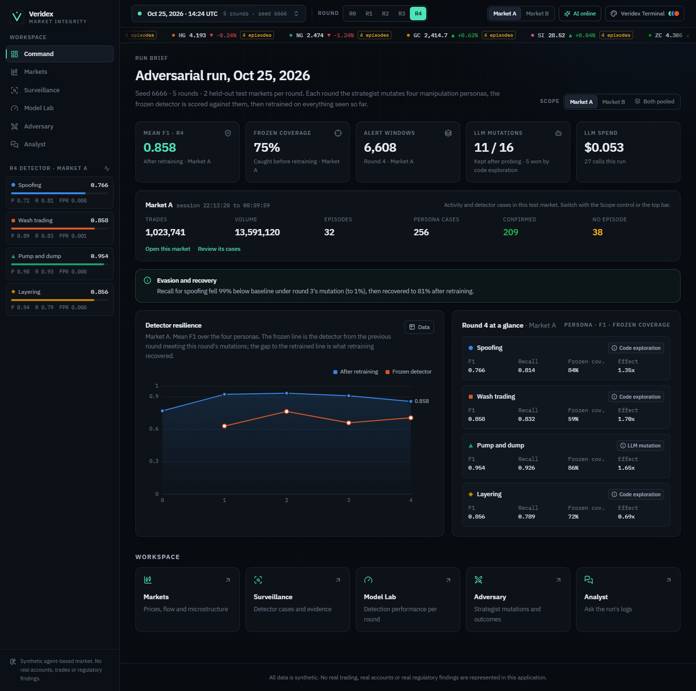

---

## Contents

1. [System architecture](#1-system-architecture)
2. [Results at a glance](#2-results-at-a-glance)
3. [Repository layout](#3-repository-layout)
4. [Modules](#4-modules)
   - [4.1 Market simulator](#41-market-simulator-srccore)
   - [4.2 Detector](#42-detector-srcdetector)
   - [4.3 Adversarial loop](#43-adversarial-loop-srcadversarial)
   - [4.4 LLM layer](#44-llm-layer-srcagentic)
   - [4.5 Real-data checks](#45-real-data-checks-srclive-srcreplay)
   - [4.6 Web API](#46-web-api-api)
5. [Web app: every page and control](#5-web-app-every-page-and-control)
6. [Setup](#6-setup)
7. [Running the project](#7-running-the-project)
8. [Configuration](#8-configuration)
9. [Outputs on disk](#9-outputs-on-disk)
10. [Tests](#10-tests)
11. [Limitations](#11-limitations)
12. [Further documentation](#12-further-documentation)

---

## 1. System architecture

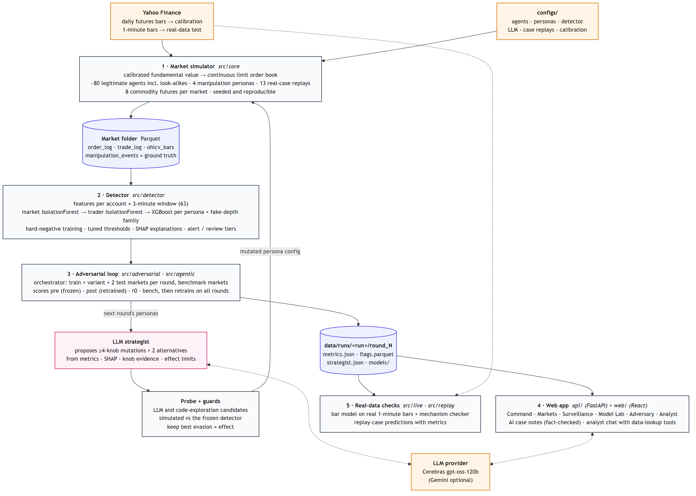

<sub>Source: [`docs/architecture/00-system-architecture.mmd`](docs/architecture/00-system-architecture.mmd). Per-module diagrams (simulator, detector, adversarial round, web app) are in [`docs/ARCHITECTURE.md`](docs/ARCHITECTURE.md).</sub>

**One adversarial round:**

1. **Strategist.** The LLM strategist reads the previous round's results and proposes new parameters for each manipulation persona. The code adds its own random exploration candidates.
2. **Probe.** Every candidate is simulated on short probe markets against the **frozen** detector. The one with the best *evasion × effect* score is kept. A guard rejects candidates that stop the manipulation from working.
3. **Simulate.** The simulator builds the round's markets with the mutated personas: 1 training market, 1 randomised-variant training market and 2 held-out test markets, each with 8 commodities.
4. **Score before retraining.** The frozen detector scores the test markets (`pre`): this shows how well the old detector transfers to unseen tactics.
5. **Retrain.** The detector is retrained on every round so far and scores the same markets again (`post`). It also scores 2 fixed benchmark markets (`bench`), and the round-0 detector scores them too (`r0`).
6. **Save.** Metrics, alerts, SHAP explanations and models are saved, and the web app reads them.

---

## 2. Results at a glance

These numbers come from run `adversarial_20261025T142453Z_seed6666` (5 rounds, 2 test markets per round, all test markets pooled).

| Persona | F1 retrained, R0 | F1 retrained, R4 | F1 frozen on R4 mutations | Benchmark F1, R0 → R4 |
|---|---|---|---|---|
| Spoofing | 0.86 | 0.77 | 0.71 | 0.60 → 0.62 |
| Layering | 0.88 | 0.85 | 0.49 | 0.11 → 0.07 |
| Wash trading | 0.43 | **0.88** | 0.75 | 0.64 → **0.88** |
| Pump-and-dump | 0.86 | **0.96** | 0.93 | 0.74 → **0.92** |
| Spoofing + layering as one family | 0.93 | 0.86 | – | – |

- **The adversary bites.** Coverage by the frozen detector drops in the rounds where a new mutation lands, and retraining recovers most of it.
- **Transfer improves.** On the fixed benchmark of unseen random variants, wash trading and pump-and-dump improved substantially over the run.
- **Spoofing and layering trade labels.** The mutations push the two schemes into each other's look. Scored as one family (they are one offence under CEA §4c(a)(5)(C)), the retrained detector holds 0.86 F1.
- **LLM strategist.** The probe kept the LLM's own candidate in **11 of 16** persona-rounds; random code exploration won the other 5.

---

## 3. Repository layout

```
Veridex/
├── api/                 FastAPI backend for the web app (reads data/runs)
├── configs/             all YAML configuration (agents, personas, detector, LLM, replays, calibration)
├── data/                runs, replay markets, calibration and live data, LLM cache (gitignored)
├── docs/                guides, architecture diagrams, screenshots, planning docs, project report
├── scripts/             command-line entry points (pipeline, simulation, replays, live tests, web app)
├── src/
│   ├── core/            market simulator: order book, calibration, agents, manipulation personas
│   ├── detector/        feature engine, anomaly forests, XGBoost classifiers, pipeline
│   ├── adversarial/     round orchestrator, metrics, effectiveness, randomised variants
│   ├── agentic/         LLM client, strategist, tools, case-note writer, analyst assistant
│   ├── live/            real-market 1-minute bar model and mechanism checker
│   ├── replay/          real-case replay simulation and scoring
│   └── utils/           I/O, Parquet schemas, logging
├── tests/               216 unit and integration tests
├── web/                 React + TypeScript + Vite front end
├── requirements.txt     Python dependencies
└── pyproject.toml       package and tool settings
```

---

## 4. Modules

### 4.1 Market simulator (`src/core`)

A seeded, agent-based **continuous double-auction** market. Every price comes from a real match between two agents' orders; nothing is drawn from a price model directly.

| File | Role |
|---|---|
| `order_book.py` | Limit order book with price-time priority. Orders rest, match, partially fill, expire or are cancelled. Contains no randomness and no ML. |
| `simulation.py` | `SimConfig` and `run_simulation(config, seed)`. Builds the agents, schedules manipulation episodes, runs the tick loop (1 tick = 1 second), and writes the logs and 100-tick bars. Also contains the `FundamentalValueProcess` (a hidden value with drift, volatility and news jumps). |
| `calibration.py` | Per-commodity start prices, contract tick sizes, daily volatility and drift, and how often each manipulation type occurs in that commodity. |
| `persona_params.py` | Maps the persona settings in `configs/persona_config.yaml` (the knobs the strategist mutates) onto the simulator's configuration. |

**Commodities:** WTI crude (CL), Brent (BZ), gold (GC), silver (SI), natural gas (NG), copper (HG), wheat (ZW) and corn (ZC). Each runs on its contract's real tick grid.

**Legitimate traders** (`src/core/agents/`). Each per-commodity count is in `SimConfig`.

| Agent | Accounts | Behaviour |
|---|---|---|
| Noise traders | `noise_*` (20) | Random small orders around the price |
| Momentum traders | `momentum_*` (8) | Follow trends |
| Mean-reversion traders | `meanrev_*` (6) | Trade toward the fundamental value and anchor the price |
| Market maker | `mm_*` (1) | Two-sided quotes every tick, with inventory skew |
| HFT liquidity providers | `hft_*` (3) | High-cancel quoting ladders |
| Execution algorithms | `algo_*` (3) | Work large institutional orders and re-post them when the price moves |
| Institutional crossing desk | `rebalance_*` (2) | Crosses client orders against each other: looks like wash trading |
| Occasional traders | `occ_*` (25) | Rare small trades, the same footprint as a manipulator's quiet periods |
| Look-alikes | `lp_*`, `hedger_*`, `fund_*` | Quote-protecting LPs (look like spoofing), ladder hedgers (look like layering), fund families (look like pump-and-dump) |

The look-alikes are deliberate: real surveillance spends most of its effort on legitimate behaviour that resembles manipulation.

**Manipulation personas** (`src/core/agents/manipulation/`). Each is modelled on documented CFTC or DOJ enforcement cases, and each account trades like an ordinary small trader outside its episodes.

| Persona | Mechanism | Tunable knobs |
|---|---|---|
| Spoofing | A large fake order on one side, a fill on the other, then the fake order is cancelled (Coscia, Sarao) | 14 |
| Layering | Several fake orders stacked on consecutive price levels, cancelled together (Sarao) | 12 |
| Wash trading | Colluding accounts trade with each other without any change in ownership (Cargill, Shinhan) | 7 |
| Pump-and-dump | Quiet accumulation, aggressive buying to push the price up, then selling into the rise | 8 |

**Real-case replays** (`replay.py`, `configs/case_replays.yaml`). These are 13 scripted cases built from public enforcement records: Sarao, Coscia/Panther, Oystacher/3Red, JPMorgan, Merrill Lynch (Pacilio, Bases), Deutsche Bank, Tower Research, Optiver, Amaranth, Moore Capital, Cargill and Shinhan/Aralia. Each entry separates what the sources **verify** from what had to be **approximated**.

**Seeds and reproducibility.** One seed drives every random stream in a market: the fundamental path, the order in which agents act within a tick, every agent's behaviour, and which episodes happen when. Each commodity gets its own seed (`crc32` of its name). The loop gives every market its own seed range (train `S+10r`, tests `S+10r+1…`, variants `+50000`, benchmark `+90000`). The same seed and configuration produce byte-identical output. Details are in [`docs/SIMULATION_GUIDE.md`](docs/SIMULATION_GUIDE.md).

### 4.2 Detector (`src/detector`)

The detector's unit is one **account in one 3-minute window**, with windows sliding every 30 seconds.

| File | Role |
|---|---|
| `features.py` | Builds 63 features per account-window from `order_log` and `trade_log` (see the groups below) |
| `anomaly.py` | Two IsolationForests: one on 8 market-context columns, one on 55 trader-behaviour columns |
| `classifiers.py` | One XGBoost classifier per persona, plus a *fake-depth* family model (spoofing ∪ layering). Thresholds are tuned on grouped out-of-fold predictions, with negative subsampling and **hard negatives**. |
| `pipeline.py` | Loads and caches features and labels, trains, scores, and builds alerts with SHAP explanations |

**Feature groups:**
- **Orders and size:** order counts, sizes relative to book depth, large and layered orders.
- **Cancellation:** cancel ratios, fast and large cancels, order life, cancelling one side while trading the other, a spoof signature.
- **Counterparties:** mutual and reciprocal trading, ring size and volume share, net flatness.
- **Cross-account links:** a large cancel by one account matched with an opposite fill by a linked account.
- **Direction and timing:** prior net position, reversals, signed flow, coordinated peers.
- **Peer-relative (`peer_z_*`):** the account compared with other accounts in the same window.
- **Self-history (`self_z_*`):** the account compared with its own earlier windows.
- **Market context (`mkt_*`):** price move, volatility, volume spike and imbalance in the market as a whole.

**Labels** are activity-based: a window is positive only when the account placed one of that scheme's manipulative orders inside it. The detector never reads `manipulation_events`, the ground-truth file.

**How a window becomes an alert:**
1. The market forest scores market unusualness, and the trader forest scores account unusualness.
2. The persona classifiers see both scores as inputs.
3. An alert is raised when a classifier crosses its tuned threshold, or when an unusual window is backed by a strong deviation from the account's own history. Windows that are unusual but unconfirmed become the *review* tier.

**Hard negatives:** benign windows of the look-alike populations, and of manipulator accounts outside their episodes, are never subsampled away and weigh 3× in the final fit. In an offline test this cut false-alarm cases by about two-thirds.

### 4.3 Adversarial loop (`src/adversarial`)

| File | Role |
|---|---|
| `orchestrator.py` | Runs a round. It simulates the markets in parallel, caches features, scores the four phases (`pre`, `post`, `r0`, `bench`), retrains on all rounds plus the replay-augmentation markets, saves models and runs the probes. |
| `metrics.py` | Window-level precision, recall, F1 and FPR. Episode coverage, any-alert coverage, family coverage and family F1. Detection latency and mutation score. |
| `effectiveness.py` | Checks the manipulation still *works* (spoof price impact, wash-volume share, pump buying pressure). Evasion counts only while the effect stays at 0.5× or more of round 0. |
| `variants.py` | Builds randomised persona variants, used as extra training diversity and as the fixed transfer benchmark |

**Mutation score:** evasion × min(1, effect ratio), where evasion = 0.5 × (1 − coverage) + 0.3 × share of episodes missed + 0.2 × detection delay.

### 4.4 LLM layer (`src/agentic`)

| File | Role |
|---|---|
| `llm_client.py` | One client for every LLM call (LiteLLM). It handles the provider switch (Cerebras `gpt-oss-120b` or Gemini), a response cache, a hard spending budget, rate limits and a per-call log (`llm_calls.jsonl`). |
| `adversarial_strategist.py` | The adversary, which makes one call per persona per round. See the details below. |
| `tools.py` | Knob bounds and effect costs, tool schemas for the strategist and the analyst, and the data-lookup tools |
| `mutation_library.py` | Hand-written fallback mutations for when the LLM is unavailable |
| `narrative_generator.py` | Writes a short case note for an alert. A fact-checker discards any note containing a number that isn't in the detector output. |
| `case_evidence.py` | Deterministic evidence: what the account actually did in the flagged span |
| `analyst_assistant.py` | Chat assistant that answers only through function calls over the run's data |

**What the strategist sees:**
- the current knob values and their bounds;
- the track record and the probe results;
- the features the detector relies on now, and which features caught it last round;
- **knob evidence**: how each knob performed in earlier probes;
- **effect limits**: values at which the effect was lost.

**What its proposals must satisfy:** every candidate changes at least **4 knobs**, each by at least **10% of its range**, and comes with **2 alternatives** that together use at least 60% of the persona's knobs. These rules are enforced in code. Candidates past a known effect limit are moved back inside before probing.

**Analyst tools:** `list_rounds`, `summarize_cases`, `compare_markets`, `run_overview`, `get_strategist_history`, `query_flags`, `query_round_metrics` and `get_trader_history`.

### 4.5 Real-data checks (`src/live`, `src/replay`)

- **`src/live`** tests the idea on real anonymous 1-minute bars from Yahoo Finance.
  - A bar-level XGBoost model is trained on scale-free bar features of the simulated markets and applied to real bars.
  - A **mechanism checker** compares each flagged window with how each scheme moves a market.
  - An **event calendar** flags scheduled releases that move prices for ordinary reasons (EIA inventories, USDA reports, and so on).
- **`src/replay`** simulates the 13 real-case replays and scores them with any saved round's detector.

### 4.6 Web API (`api/`)

FastAPI reads `data/runs/` and also serves the built React app, so normal use needs a single process and a single address.

| Endpoint | Purpose |
|---|---|
| `GET /api/runs`, `/api/runs/{run}/rounds` | Run list (with an F1 sparkline) and rounds with their test markets |
| `GET …/rounds/{r}/summary` | Round metrics, mutation sources and effect ratios |
| `GET …/market/overview`, `…/market/commodity/{c}` | Cross-asset session and the per-commodity terminal |
| `GET …/cases`, `…/cases/{id}`, `…/cases/{id}/raw` | Detector cases, case detail with SHAP and evidence, raw orders and trades |
| `POST …/cases/{id}/narrative` | Fact-checked AI case note |
| `GET /api/runs/{run}/performance`, `/params`, `/strategist` | Metrics across rounds, parameter history, strategist record |
| `POST /api/runs/{run}/chat` | Analyst assistant |
| `GET /api/ai/status`, `/api/health` | Whether the LLM features are available, and server health |

Endpoints accept `market=` (a single test market) or pooled scope. Results are cached in memory.

---

## 5. Web app: every page and control

The front end is React 18, TypeScript, Vite, Tailwind CSS, ECharts, TanStack Query, Framer Motion and react-markdown. Every chart has a **Data** button that switches it to a table view, and most charts support hover tooltips and scroll-to-zoom.

### Global shell (on every page)

| Control | What it does |
|---|---|
| **Sidebar navigation** | Command · Markets · Surveillance · Model Lab · Adversary · Analyst. On phones it opens from the ☰ button. |
| **Detector panel** (sidebar) | Per-persona F1, precision, recall and FPR of the selected round's detector for the selected market |
| **Run picker** | Searchable list of every adversarial run, showing date, seed, round count, final F1 and an F1 sparkline. Keyboard-friendly (↑ ↓ Enter Esc). |
| **Round scrubber** | `R0 … Rn`. R0 is the baseline; later rounds carry mutated personas. |
| **Market toggle** | Market A / Market B (one per held-out test market) |
| **Scope switch** | On metric pages: a single test market, or **Both pooled** (the pipeline's official numbers) |
| **Ticker tape** | Scrolling session close and change for all 8 commodities, with episode counts. Pauses on hover. |
| **AI status pill** | Shows whether the LLM features are online, with the reason when they're offline |
| **Theme picker** | 9 themes (7 dark, 2 light), remembered per device. **Shift+T** cycles through them. |
| **URL state** | Run, round, market, scope, commodity and selected case live in the URL, so every view can be shared |

<p align="center">
  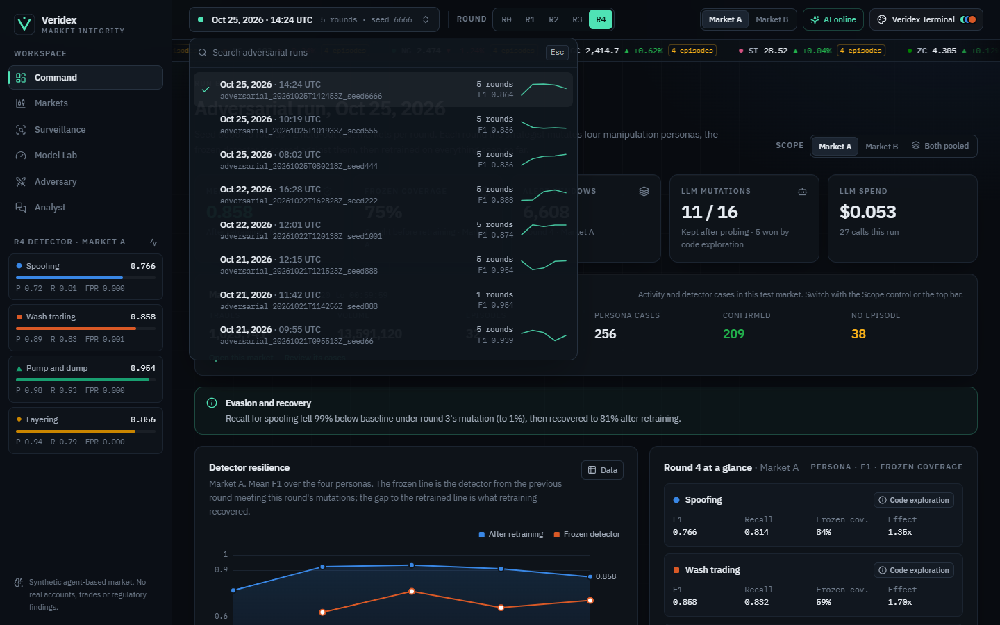
  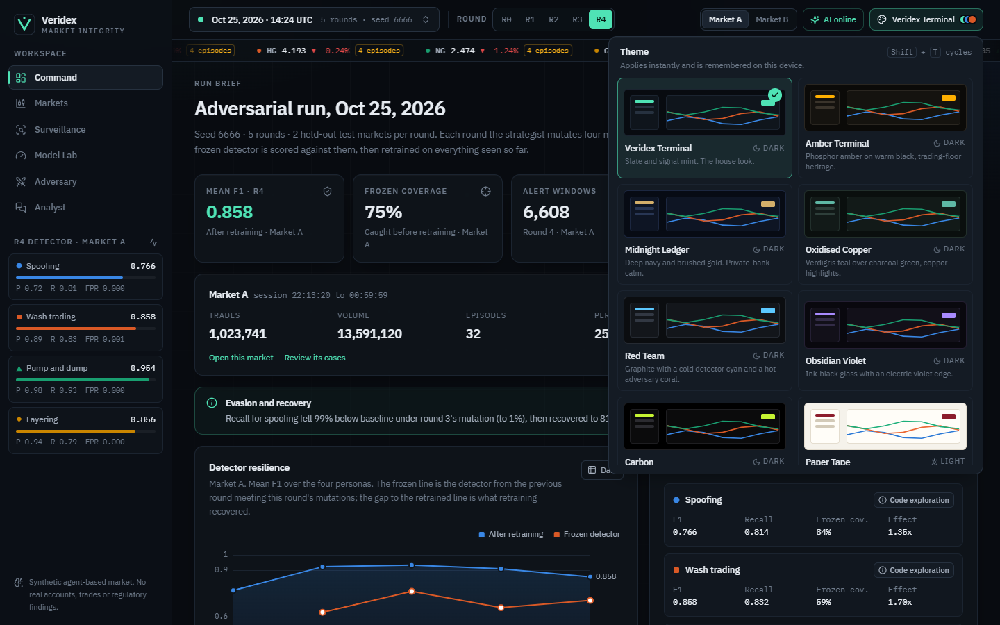
</p>

Themes: Veridex Terminal, Amber Terminal, Midnight Ledger, Oxidised Copper, Red Team, Obsidian Violet, Carbon, **Paper Tape** (light) and **Glacier** (light).

<p align="center">
  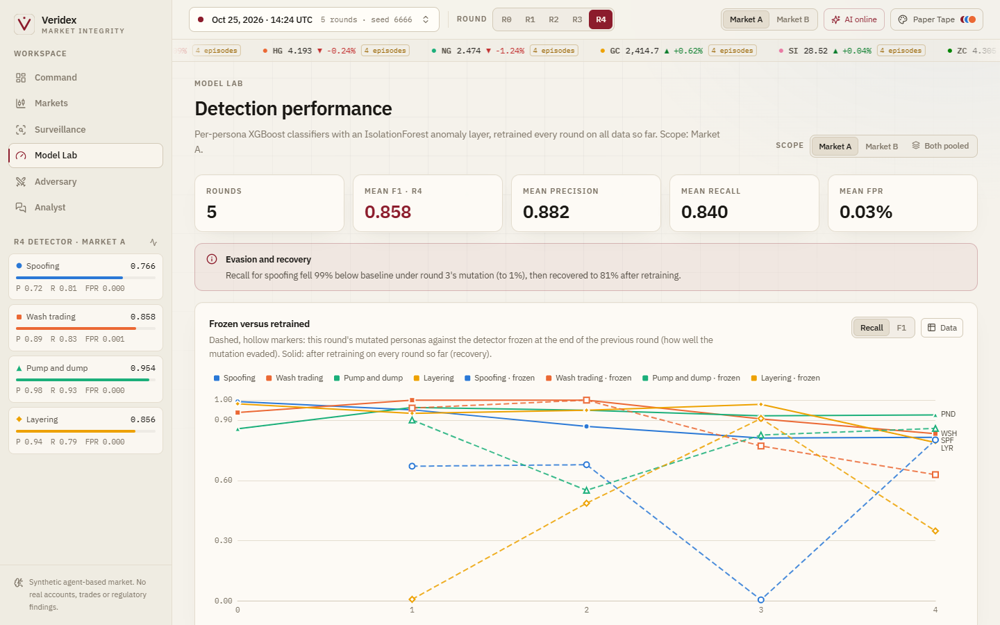
  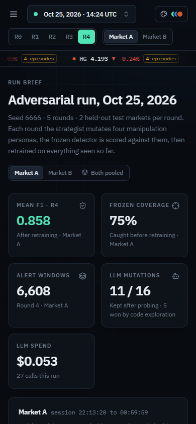
</p>

### 5.1 Command — run brief


- **Header:** run date, seed, number of rounds and number of test markets per round, plus the scope switch.
- **Stat tiles:**
  - **Mean F1** of the retrained detector;
  - **Frozen coverage**: the share of episodes caught *before* retraining;
  - **Alert windows**;
  - **LLM mutations kept**, with how many code exploration won;
  - **LLM spend** and call count.
- **Market strip:** the selected market's trades, volume, episodes, persona cases, confirmed and no-episode counts, with links to *Open this market* and *Review its cases*.
- **Evasion and recovery:** a one-line headline, for example "recall for spoofing fell 99% under round 3's mutation, then recovered to 81% after retraining".
- **Detector resilience chart:** retrained F1 against frozen F1 by round. The gap between the lines is what retraining recovered.
- **Round at a glance:** for each persona, F1, recall, frozen coverage, effect ratio, and whether the mutation came from the LLM or from code exploration.
- **Workspace cards:** shortcuts to the other pages.

### 5.2 Markets — prices, flow and microstructure

The commodity tabs across the top switch between the cross-asset view and each book. A warning-coloured badge shows each book's ground-truth episode count.

**All markets**

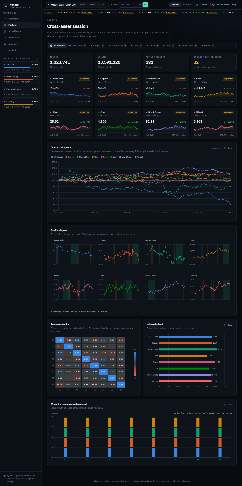

- **Tiles:** trades, volume, active accounts and ground-truth episodes.
- **Commodity cards:** ticker, sector, last price, change, sparkline, volume, trades and episode badge. Click a card to open that book.
- **Indexed price paths:** every contract rebased to 100 at the open. The **Episodes** chip shades manipulation spans.
- **Small multiples:** each book on its own scale, with shading coloured by persona.
- **Return correlation:** a Pearson correlation heatmap of bucketed returns.
- **Volume by book** and **Where the manipulation happened** (episodes per commodity, split by persona).

**Single commodity terminal**

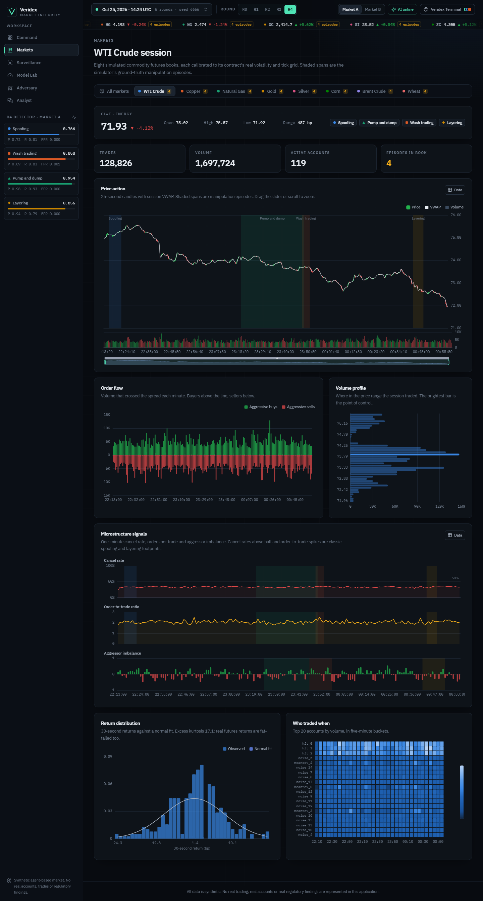

- **Price action:** candles with session VWAP and shaded episodes, plus a zoom slider.
- **Order flow:** aggressive buy and sell volume per minute.
- **Volume profile:** where the session traded, with the point of control highlighted.
- **Microstructure signals:** one-minute cancel rate, orders per trade and aggressor imbalance. These are the classic spoofing and layering footprints.
- **Return distribution:** 30-second returns against a normal fit, with excess kurtosis.
- **Who traded when:** the top 20 accounts by volume in five-minute buckets.

### 5.3 Surveillance — detector cases and evidence

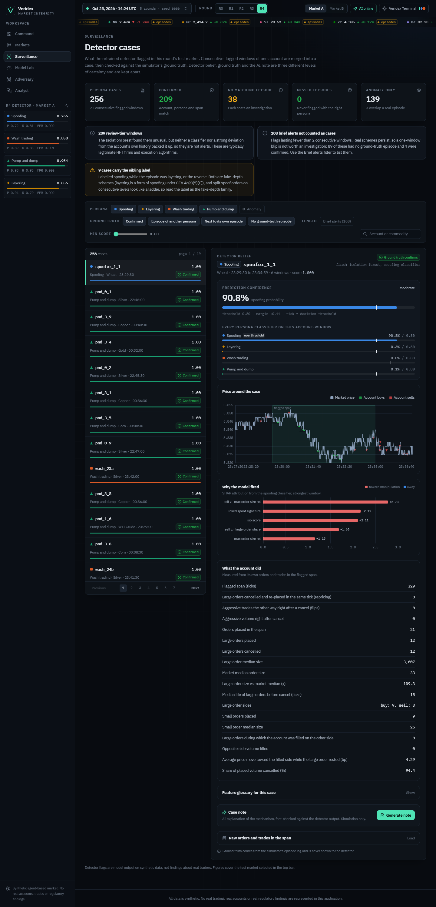

- **KPI tiles:**
  - persona cases (2 or more consecutive flagged windows);
  - **Confirmed:** the account, persona and span match ground truth;
  - **No matching episode:** false alarms, each of which would cost an investigation;
  - **Missed episodes;**
  - **Anomaly-only** alerts.
- **Callouts:**
  - *review-tier windows*: unusual but unconfirmed;
  - *brief alerts*: single-window flags, not counted as cases;
  - *sibling label*: spoofing called layering or the reverse.
- **Missed ground-truth episodes:** an expandable table.
- **Filters:**
  - **Persona** chips: Spoofing, Layering, Wash trading, Pump and dump, Anomaly;
  - **Ground truth** chips: Confirmed, Episode of another persona, Next to its own episode, No ground-truth episode;
  - **Length**: show brief alerts;
  - **Min score** slider;
  - **Account or commodity** search.
- **Case list:** paged, with account, persona, commodity, time, score and a ground-truth badge.

**Case detail** (the selected case)

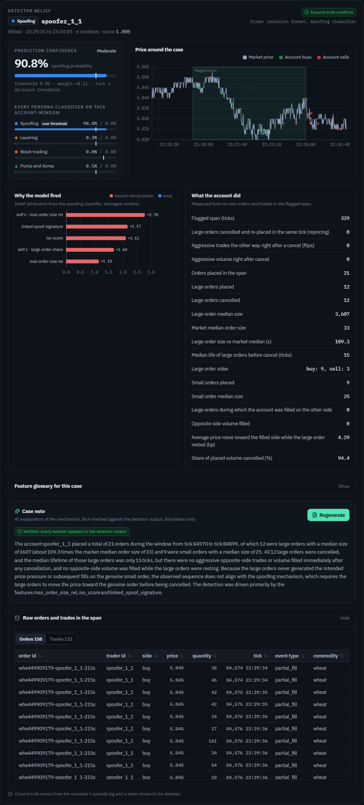

- **Detector belief:** persona, account, time span, window count, score, which layers fired, and the ground-truth verdict.
- **Prediction confidence:** the probability against the tuned threshold, with the margin, and every persona classifier's probability for the same window.
- **Price around the case:** the market price with the account's buys and sells and the flagged span.
- **Why the model fired:** a SHAP bar chart from the classifier that raised the alert.
- **What the account did:** deterministic evidence, such as large orders placed and cancelled, size against the market median, order life, fills on the opposite side, and price move while resting.
- **Feature glossary:** a plain-language meaning for each feature behind the case.
- **Case note:** *Generate note* writes an AI explanation of the mechanism. It's shown only if every number in it appears in the detector output ("Verified").
- **Raw orders and trades in the span:** sortable tables of every order event and trade.

### 5.4 Model Lab — detection performance

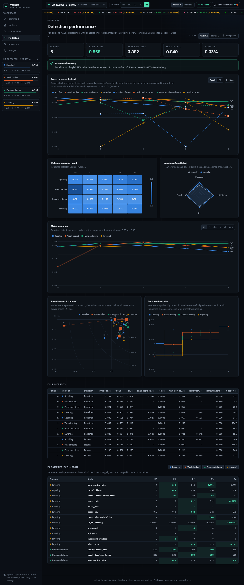

- **Tiles:** rounds, plus mean F1, precision, recall and FPR for the latest round.
- **Evasion and recovery** headline.
- **Frozen versus retrained:** a **Recall / F1** toggle comparing the frozen and retrained detector for each persona and round.
- **F1 by persona and round:** a heatmap.
- **Baseline against latest:** precision, recall, F1 and FPR (scaled ×10), R0 against the latest round.
- **Metric evolution:** per-persona lines, with reference lines at 0.70 and 0.90.
- **Precision-recall trade-off:** every persona-round as a point, sized by support, over iso-F1 curves.
- **Decision thresholds:** each persona's tuned threshold by round.
- **Full metrics table:** round, persona, frozen or retrained, precision, recall, F1, **fake-depth F1**, FPR, any-alert coverage, family coverage, barely-caught share and support.
- **Parameter evolution:** the parameters each persona actually ran with each round, with changed cells highlighted. Persona chips filter it.

### 5.5 Adversary — strategist mutations

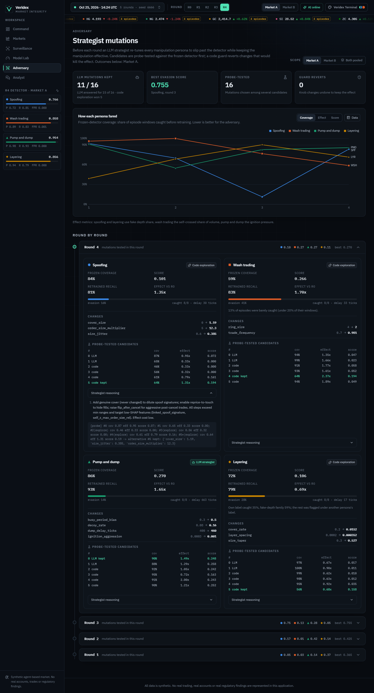

- **Tiles:** **LLM mutations kept** (and how often the LLM answered, against code-exploration wins), best evasion score, number of probe-tested mutations, and guard reverts.
- **How each persona fared:** a lens toggle switches between **Coverage** (frozen coverage), **Effect** (manipulation effect against round 0) and **Score** (mutation score).
- **Round by round:** one card per persona per round, showing:
  - a source badge (*LLM strategist*, *Code exploration* or *Hand-written fallback*);
  - the knob changes (old → new);
  - frozen coverage, own-label and family coverage, episodes caught, delay, retrained recall, effect ratio and score;
  - the **probe-tested candidates** table (coverage, effect and score, marked *LLM* or *code*, with the kept one highlighted);
  - expandable **Strategist reasoning**.

### 5.6 Analyst — ask the run

<p align="center">
  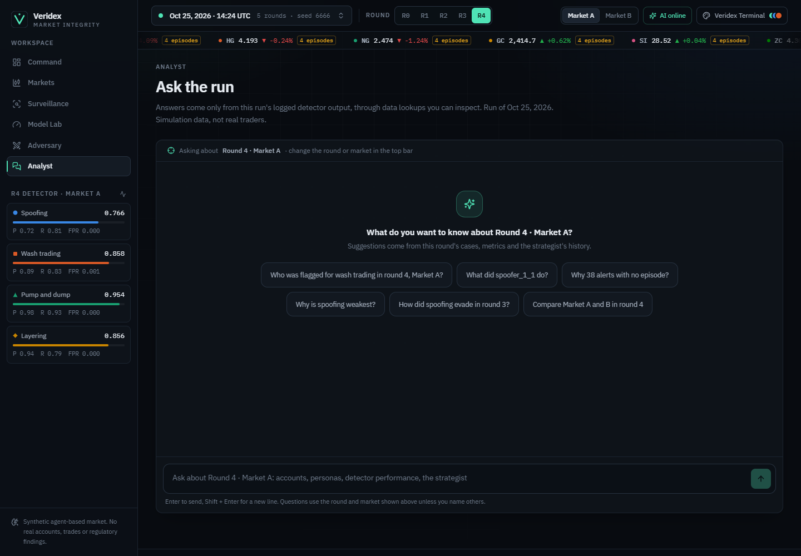
  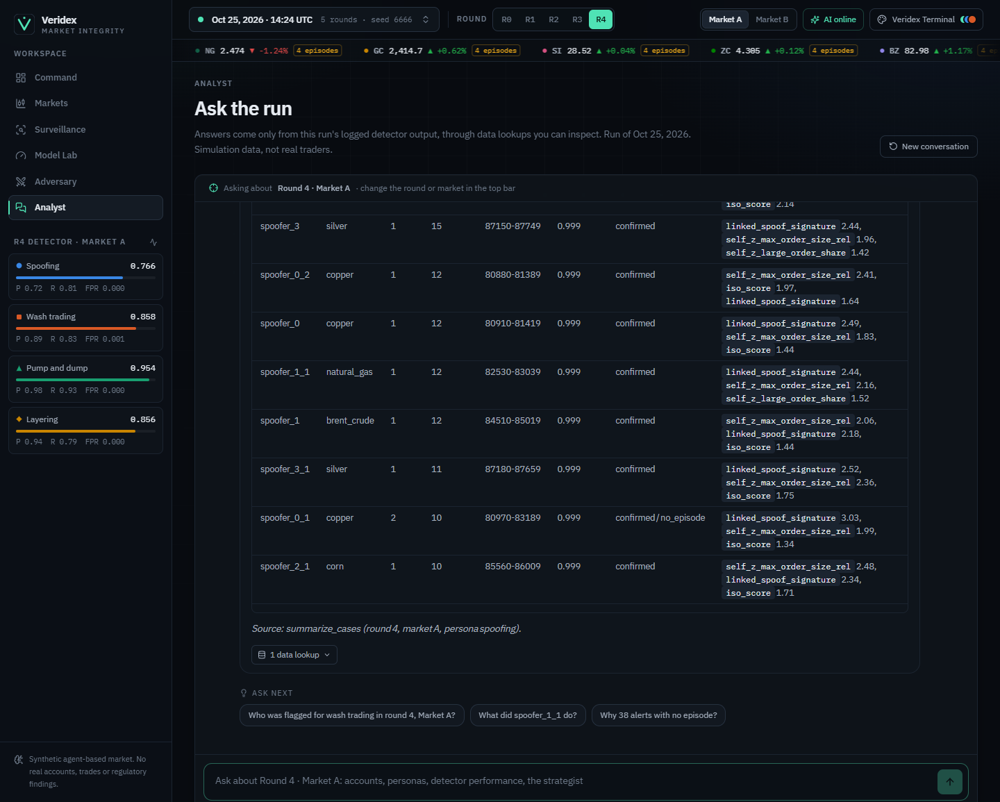
</p>

- A chat about the selected round and market. Answers come only from the run's logged outputs, through data-lookup tools.
- **Suggested questions** adapt to the run, for example "Who was flagged for spoofing?", "What did this account do?", "Why N alerts with no episode?", "How did the strategist do?" and "Compare the markets".
- Each answer can show its **data lookups** (the tool calls and arguments) and cites its source. Tables and markdown are rendered.
- **New conversation** clears the chat. The context bar shows which round and market the questions refer to.

---

## 6. Setup

**Requirements:** Python 3.11 or 3.12, Node.js 18 or later, and Windows, macOS or Linux. The commands below use Windows PowerShell paths; on macOS and Linux use `.venv/bin/python`.

```powershell
git clone <repo-url> Veridex
cd Veridex

# Python environment
python -m venv .venv
.\.venv\Scripts\python -m pip install -r requirements.txt

# Web app
cd web
npm install
npm run build
cd ..

# Secrets
copy .env.example .env      # then fill in the keys
```

**`.env`** (never committed):

| Variable | Purpose |
|---|---|
| `LLM_PROVIDER` | `cerebras` (default) or `gemini`. Every LLM call goes to this one provider. |
| `CEREBRAS_API_KEY` | Key for Cerebras `gpt-oss-120b` |
| `GEMINI_API_KEY` | Optional: only needed when `LLM_PROVIDER=gemini` |
| `DEMO_MODE` | `true` forces cached LLM responses (offline demos) |
| `LOG_LEVEL` | `INFO`, `DEBUG`, and so on |

Spending on Cerebras is capped by `cerebras_budget` in `configs/llm_config.yaml`. The running total is kept in `data/llm_cache/cerebras_spend.json`. Delete or reset that file when you add credit or change key.

---

## 7. Running the project

### Full adversarial pipeline

```powershell
.\.venv\Scripts\python scripts\run_full_pipeline.py --rounds 5 --seed 42
```

| Option | Default | Meaning |
|---|---|---|
| `--rounds` | 3 | Rounds, including the round-0 baseline |
| `--ticks` | 5000 | Ticks per market (1 tick = 1 second) |
| `--seed` | 42 | Master seed |
| `--test-markets` | 2 | Held-out test markets per round (4 gives steadier estimates at about 1.5× the simulation time) |
| `--mutations` | `llm` | `llm`, or `hand` for the hand-written library with no LLM calls |
| `--persona` | `all` | Mutate a single persona only |
| `--commodity` | `all` | Restrict to one commodity |
| `--no-probe` | off | Skip candidate probing (faster, weaker adversary) |
| `--run-name` | – | Label appended to the run id |

A 5-round run with the defaults takes about 2–2.5 hours on an 8-core machine and makes about 30 LLM calls (around 5 US cents on Cerebras).

### Web app

```powershell
.\scripts\webapp.ps1 start          # builds if needed, serves http://localhost:8000 in the background
.\scripts\webapp.ps1 status | stop | restart
.\scripts\webapp.ps1 start -Lan     # reachable from phones on the same Wi-Fi
.\scripts\webapp.ps1 start -Public -Password secret   # temporary public link via a Cloudflare tunnel
```

To run the server manually, or for development with live reload, see [`docs/WEB_APP.md`](docs/WEB_APP.md).

### Other scripts

| Script | Purpose |
|---|---|
| `run_simulation.py` | Simulate one market (all commodities) without the loop |
| `replay_cases.py` | Simulate the real-case replays and score them with each saved round |
| `replay_predictions.py` | Per-market and per-case predictions with precision, recall and F1 on the replay markets |
| `fetch_market_data.py` / `predict_live.py` | Fetch real 1-minute bars and score them with a round's bar model and the mechanism checker |
| `fetch_calibration_data.py` | Download 5 years of daily futures bars from Yahoo Finance |
| `calibrate_sim_volatility.py` | Fit the simulator's per-commodity volatility correction (`configs/sim_calibration.yaml`) |
| `verify_stylized_facts.py` | Check simulated returns for fat tails, volatility clustering and similar properties (writes `docs/stylized_facts_report.md`) |
| `save_round_models.py` | Backfill saved models for older runs |
| `visualize_results.py`, `plot_windows.py`, `parquet_to_csv.py` | Plots and exports |
| `test_cerebras.py` | Check that the Cerebras key works |

---

## 8. Configuration

| File | Contents |
|---|---|
| `configs/agent_config.yaml` | Agent population and behaviour defaults |
| `configs/persona_config.yaml` | Round-0 baseline per persona; the strategist writes each round's mutation here |
| `configs/detector_config.yaml` | Feature windows, isolation forests, XGBoost, thresholds, subsampling, **hard negatives**, family models, case rules (`alert_cases`), loop settings, replay augmentation and replay check |
| `configs/llm_config.yaml` | Provider, model, budget and rate limits, and per-module token limits. Also the strategist's rules: `min_llm_knobs`, `min_knob_move`, `llm_knob_coverage`, `max_attempts_per_persona` and exploration candidates. |
| `configs/case_replays.yaml` | The 13 real-case scripts, with sources and verified and approximated facts |
| `configs/sim_calibration.yaml` | Volatility correction factors |

---

## 9. Outputs on disk

```
data/runs/adversarial_<timestamp>_seed<S>/
├── round_summary.parquet   every round × persona × phase (pre / post / r0 / bench)
├── round_metrics.parquet   schema-checked pre/post subset
├── llm_calls.jsonl         every LLM request and response, with cost
├── llm_reasoning.log       the strategist's reasoning per round
├── benchmark/market_0..1   fixed unseen-variant markets
└── round_N/
    ├── train/ train_variant/ test/ test_1/   market folders (Parquet logs, features, labels)
    ├── flags.parquet       the retrained detector's verdict on every test window
    ├── metrics.json  thresholds.json  strategist.json  shap_importance.json
    └── models/             detector.joblib, bar_model.joblib, manifest.json
```

Every Parquet file and column is described in [`docs/SIMULATION_GUIDE.md`](docs/SIMULATION_GUIDE.md).

---

## 10. Tests

```powershell
.\.venv\Scripts\python -m pytest -q tests
```

There are 216 tests. They cover the order book, schemas, simulation reproducibility and realism, the look-alike agents, features (including the cross-account links), the classifiers and the fake-depth family metric, the transfer benchmark, the strategist's rules (shape, novelty, effect limits), the LLM client and budget guard, and the API case logic.

---

## 11. Limitations

- **Synthetic market.** The agents are stylised and are not reconstructed real accounts. The replays follow the documented *pattern* of each case, not its actual trades, which were never published.
- **Calibration.** Daily volatility and drift come from literature-based constants and are checked against 5 years of Yahoo Finance data. The simulated market is somewhat calmer than 2021–2026 reality (about 15–40% lower daily volatility).
- **Irreducible overlap.** A crossing session that nets out is the same in the data as a wash trade. Only beneficial ownership tells them apart, and the simulator has no signal for that. Some false alarms on the crossing desk are expected.
- **Spoofing and layering.** Mutations push the two into each other's look. Read their labels as one fake-depth family; the *fake-depth F1* column reports exactly that.
- **Real data.** Anonymous 1-minute bars cannot show accounts or cancellations, so the live check is a plausibility screen, not detection.

---

## 12. Further documentation

| Document | Topic |
|---|---|
| [`docs/ARCHITECTURE.md`](docs/ARCHITECTURE.md) | Module-by-module architecture with diagrams and technical specs |
| [`docs/SIMULATION_GUIDE.md`](docs/SIMULATION_GUIDE.md) | How the simulation works, seeds, and every Parquet file and column |
| [`docs/SIMULATION_AND_FEATURE_PIPELINE.md`](docs/SIMULATION_AND_FEATURE_PIPELINE.md) | Calibration, agents, features and labels in depth |
| [`docs/PREDICTION_AND_EVALUATION.md`](docs/PREDICTION_AND_EVALUATION.md) | Training, thresholds, metrics and evaluation |
| [`docs/WEB_APP.md`](docs/WEB_APP.md) | Running and hosting the web app (local, LAN, public link) |
| [`docs/LIVE_TESTING.md`](docs/LIVE_TESTING.md) | Testing against real market data |
| [`docs/enforcement_case_notes.md`](docs/enforcement_case_notes.md) | Notes on the enforcement cases behind the personas |
| [`docs/FUTURES_AND_MARKET_DOMAIN_GUIDE.md`](docs/FUTURES_AND_MARKET_DOMAIN_GUIDE.md) | Futures and market-microstructure primer |
| [`docs/planning/`](docs/planning/) | Original SRS, project plan and implementation plan |
| [`docs/report/`](docs/report/) | Project report (DOCX and PDF) |
