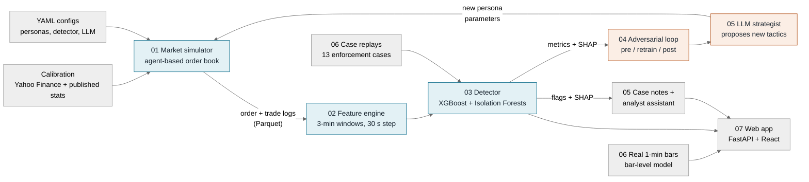
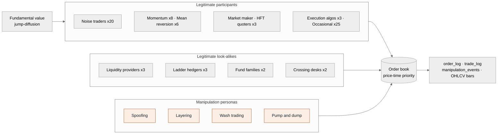
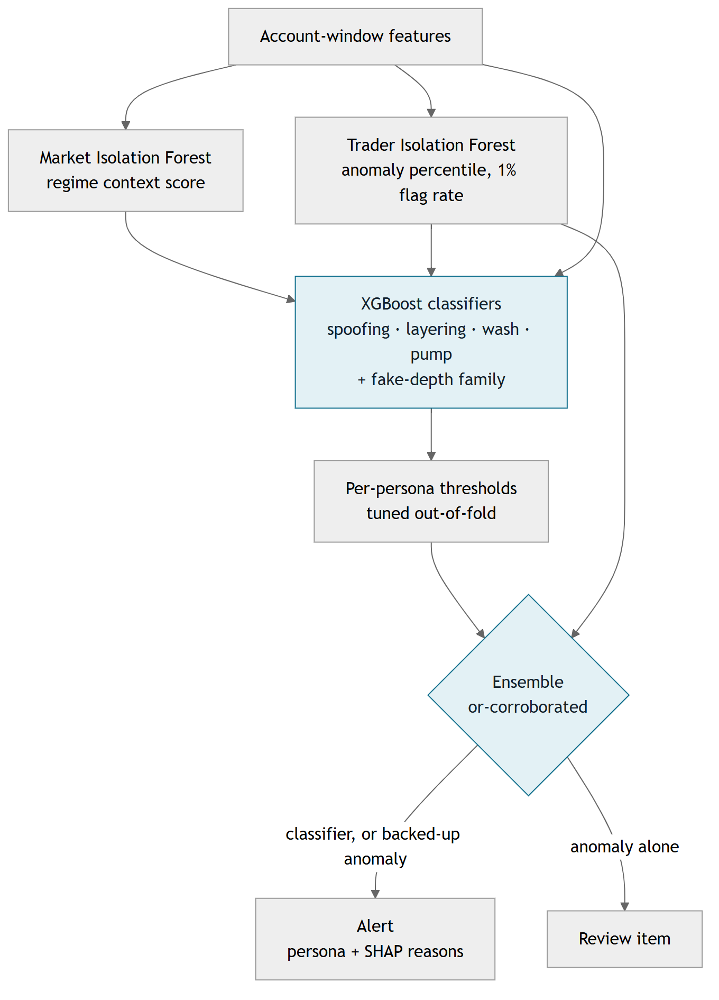
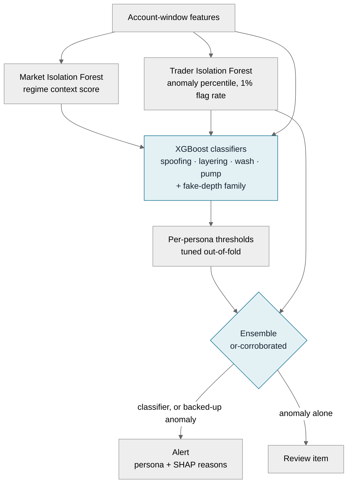
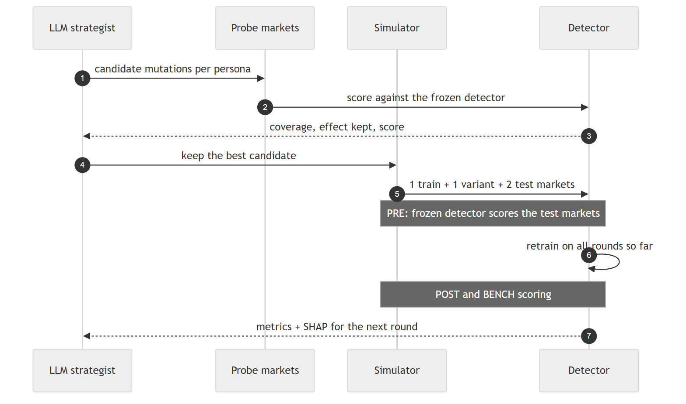
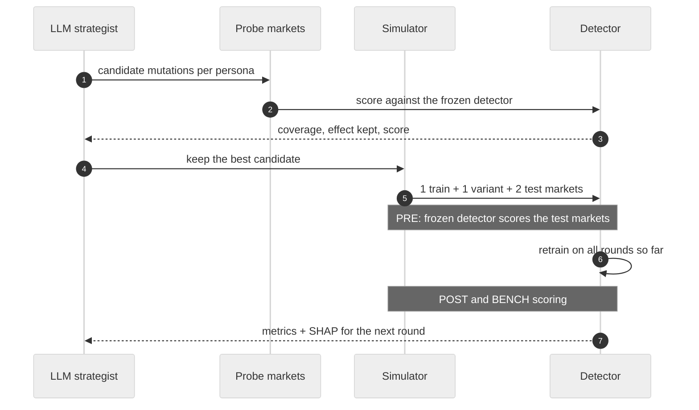
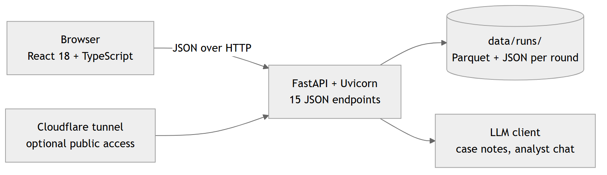
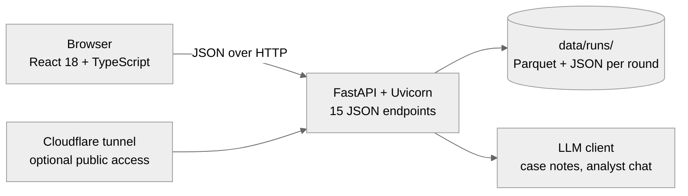

# Veridex architecture

Veridex is an agent-based commodity futures market with manipulators and legitimate look-alikes inside it, a machine-learning surveillance detector, and an LLM adversary that keeps changing the manipulators' tactics to beat the detector. The detector retrains after every round, and every result is checked against the simulator's ground truth.

| 8 | 4 | 11 | 60+ | 13 | 197 |
|---|---|---|---|---|---|
| commodity futures | manipulation schemes | legitimate trader types | features per account-window | replayed enforcement cases | unit tests |

The diagrams below are PNGs rendered from the Mermaid sources in [`architecture/`](architecture/). To change a diagram, edit its `.mmd` file and re-render it (see [Updating the diagrams](#updating-the-diagrams)).

---

## 1. System overview


Seven modules in one loop: simulate, detect, attack, retrain, explain.

- **Blue (core path):** the simulator produces order and trade logs; the feature engine turns them into account-window rows; the detector scores them.
- **Orange (adversary):** after each round, the adversarial loop hands metrics and SHAP explanations to the LLM strategist, which proposes new manipulation parameters for the next round.
- **Outside checks:** 13 replayed enforcement cases test the detector against documented schemes, and a separate bar-level model scores real 1-minute market data.

<details>
<summary>Mermaid source</summary>



</details>

---

## 2. Market simulator — `src/core/`


Each commodity runs its own continuous double-auction order book with price-time priority on the contract's real tick size. One tick is one second of a 6.5-hour session. Agents see a read-only book snapshot and send orders; arrival order is shuffled every tick, and a run is fully reproducible from its seed.

The **look-alikes** behave like manipulators for a business reason: liquidity providers pull the opposite quote when hit, hedgers work large one-sided ladders, fund families buy together across sub-accounts, and crossing desks match clients against each other. They are what makes detection hard.

| Persona | What it does | Real-case basis |
|---|---|---|
| Spoofing | Rests a large fake order near the touch, fills a small genuine order on the other side, cancels the fake. | Sarao, Coscia, Oystacher |
| Layering | Stacks fake orders on consecutive price levels, cancelled together once the genuine order fills. | Tower Research |
| Wash trading | Commonly controlled accounts trade with each other: volume printed, no change in ownership. | Cargill, Shinhan |
| Pump and dump | Coordinated accounts accumulate, ignite momentum, then sell into the followers. | Momentum-ignition guidance |

| Spec | Value |
|---|---|
| Markets | WTI crude, Brent crude, gold, silver, natural gas, copper, wheat, corn (one process each) |
| Price process | Jump-diffusion fundamental value, volatility calibrated to realised 5-minute volatility |
| Calibration | Yahoo Finance (`yfinance`) with published-statistics fallback |
| Persona knobs | 6–15 per persona (size, cancel timing, accounts, cover trades, timing) |
| Ground truth | Hidden audit tag on every manipulative order; episodes logged with accounts, span, parameters |
| Output | Parquet, validated with Pandera schemas, written atomically |

<details>
<summary>Mermaid source</summary>



</details>

---

## 3. Feature engine and labels — `src/detector/features.py`

Surveillance scores accounts, not markets. Every active account gets one row per rolling window describing its own orders, cancels, fills and counterparties, plus market context and comparisons with peers and with its own history.

| Group | Example features | Targets |
|---|---|---|
| Order behaviour | cancel ratio, fast-cancel ratio, large-order share, order size vs. market | Spoofing, layering |
| Bait-and-switch | spoof signature, and the same pattern across two linked accounts | Spoofing, layering |
| Ladders | layered-order share (same tick, same side, 3+ price levels) | Layering |
| Counterparties | mutual-counterparty share, ring size, net flatness | Wash trading |
| Position and flow | long-net ratio, reversal score, aggressor ratio, coordinated peers | Pump and dump |
| Context | peer z-scores, self-history z-scores, market volatility and volume spikes | All |

- **Window / step:** 3 minutes / 30 seconds, overlapping. One row = (commodity, window, account), 60+ numeric features.
- **Causal:** a window only uses data up to its own end.
- **Labels:** positive only where the account placed manipulative orders inside its episode; cover trades and quiet accumulation are not labelled.

---

## 4. Detector — `src/detector/`



- One binary **XGBoost** model per persona, plus a **fake-depth family** model trained on spoofing and layering together (a split spoof looks like a ladder).
- Two **Isolation Forests**: one per account-window (anomaly percentile) and one for the market regime. Both scores are also classifier inputs.
- **Thresholds** are tuned on out-of-fold predictions grouped by simulated market.
- **Ensemble "or-corroborated":** an anomaly flag alone is only a review item; it becomes an alert when a classifier or the account's own history backs it up.
- Every alert carries its top **SHAP** contributions.

| Spec | Value |
|---|---|
| Classifier | XGBoost: 300 trees, depth 4, learning rate 0.05, class weighting, negatives subsampled 50% and re-weighted |
| Anomaly models | scikit-learn Isolation Forest, robust scaling, percentile calibration, 1% flag rate |
| Retraining | Cumulative: rounds 0..N + randomised variant markets + 5 real-case replays |
| Saved per round | `round_N/models/detector.joblib`, thresholds, SHAP importance, `flags.parquet` |

<details>
<summary>Mermaid source</summary>



</details>

---

## 5. Adversarial loop — `src/adversarial/orchestrator.py`



The attacker and the detector take turns. Every candidate mutation is first tested on short probe markets against the frozen detector; the best one is used for the real round. The adversary is scored on evasion that still works, so hiding by no longer manipulating earns nothing:

```text
evasion = 0.5 × (1 − coverage) + 0.3 × episodes missed + 0.2 × detection delay
score   = evasion × min(1, effect ratio)        (0 if the effect falls below 50% of round 0)
```

| Spec | Value |
|---|---|
| Markets per round | 1 training + 1 randomised-variant training + 2 held-out test (`--test-markets`, default 2), all 8 commodities, separate seeds |
| Benchmark | 2 fixed markets of unseen random variants, simulated once, never trained on |
| Probes | 4 commodities × 2 seeds × 6,000 ticks per candidate set, in parallel |
| Effect measures | fake-depth share (spoofing, layering), wash-volume share, pump price lift |
| Parallelism | Simulations as subprocesses sharing the CPUs; features in a process pool; failed simulations retried once |

<details>
<summary>Mermaid source</summary>



</details>

---

## 6. LLM agents — `src/agentic/`

| Agent | Job | Guardrails |
|---|---|---|
| 4A Case notes | Writes a 4–6 sentence analyst note for a flagged case from its evidence and SHAP values. | Fact-grounding validator rejects numbers not in the evidence; one retry. |
| 4B Adversarial strategist | Reads the track record, SHAP and tactic cards; proposes persona mutations plus alternatives through a tool call. | Bounds validated in code, effect guard, novelty checks, hand-authored fallback. |
| 4C Analyst assistant | Answers analyst questions about flags, traders and model performance. | Answers only through tool calls over run outputs, cites sources, declines out-of-scope questions. |

- **Model:** Cerebras `gpt-oss-120b` (default) or Google Gemini, switched with one setting.
- **Client:** LiteLLM with response cache, retry/backoff, rate and token-per-minute limits, and a spend ledger with a budget cap.
- **Logging:** every call in `llm_calls.jsonl`; strategist reasoning in `llm_reasoning.log`.

---

## 7. Validation and real data — `src/replay/`, `src/live/`

- **Enforcement-case replays:** 13 documented cases scripted from public enforcement records (Sarao, Oystacher, Tower Research, Deutsche Bank, Cargill, Amaranth, JPMorgan and others). 5 are used in training; 8 are held out and re-checked after every retrain.
- **Real-market check:** real 1-minute bars from Yahoo Finance for the 8 contracts are scored by a separate bar-level XGBoost model. Public data has no account ids, so it flags suspicious windows, never traders. The model reports its held-out accuracy on simulated markets next to every real-data prediction.

---

## 8. Web app and API — `api/`, `web/`



| Page | Shows |
|---|---|
| Command | Run overview: detection quality per persona, alerts, effect of the latest mutation |
| Markets | Price, order flow, depth, return distribution, account activity heat map |
| Surveillance | Alerts merged into cases, matched to ground truth, with SHAP evidence and an AI case note |
| Adversary | Each round's mutations, the strategist's reasoning and probe results |
| Model Lab | Pre/post retrain curves, thresholds, feature importance |
| Analyst | Chat with the analyst assistant, with cited sources |

- **Frontend:** React 18, TypeScript, Vite, Tailwind CSS, Apache ECharts, TanStack Query, Framer Motion.
- **Backend:** FastAPI on Uvicorn serves the built React app and 15 JSON endpoints; TTL caches; optional password; optional Cloudflare tunnel for public access.
- **Legacy:** Streamlit dashboard in `dashboard/` with the same data views.

<details>
<summary>Mermaid source</summary>



</details>

---

## 9. Evaluation protocol

| Phase | Detector | Data | Question it answers |
|---|---|---|---|
| `pre` | Frozen from the previous round | This round's test markets | Did the new mutation evade? (worst case) |
| `post` | Retrained on rounds 0..N | This round's test markets | Does it recover once it has seen the tactic? |
| `bench` | Retrained on rounds 0..N | Fixed unseen random variants | Does it generalise to tactics it never saw? |
| `r0` | The original round-0 detector | This round's test markets | How far have the schemes drifted from the baseline? |

Metrics: precision, recall, F1 and false-positive rate per persona; episode coverage and detection latency; any-alert "caught" coverage; mutation score and effect ratio; held-out case replays.

**Leakage controls:** train, test, variant, benchmark and probe markets use separate seeds; thresholds are tuned out-of-fold by market; features are causal; no feature carries an account identifier. A leakage audit found zero test rows identical to a training row, and the round-0 detector scoring near zero on later rounds' markets confirms the classifiers learn behaviour rather than shortcuts.

---

## 10. Tech stack

| Layer | Technologies |
|---|---|
| Language | Python 3.11+, TypeScript 5.6 |
| Simulation and data | NumPy, pandas, SciPy, PyArrow (Parquet), Pandera, YAML configs |
| Machine learning | XGBoost, scikit-learn (Isolation Forest, GroupKFold), SHAP |
| LLM | LiteLLM, Cerebras gpt-oss-120b, Google Gemini, Pydantic, Tenacity |
| API and UI | FastAPI, Uvicorn, React, Vite, Tailwind, ECharts, Streamlit, Plotly |
| Market data | yfinance (calibration and real 1-minute bars) |
| Quality | pytest (197 tests), Hypothesis, Ruff, mypy, Black |
| Reproducibility | Seeded runs, atomic writes, per-round metrics and saved models |

Run the loop and the web app:

```text
.\.venv\Scripts\python.exe scripts/run_full_pipeline.py --rounds 5 --ticks 10000 --seed 1003
scripts\webapp.ps1        # web app at http://localhost:8010
```

---

## Updating the diagrams

Edit a `.mmd` file in `docs/architecture/`, then re-render it (uses your installed Chrome; nothing is added to the project):

```text
$env:PUPPETEER_SKIP_DOWNLOAD="true"
npx -y @mermaid-js/mermaid-cli@11.4.2 -i docs/architecture/03-detector.mmd -o docs/architecture/03-detector.png -b white -s 2 -p puppeteer.json
```

where `puppeteer.json` contains `{"executablePath": "C:/Program Files/Google/Chrome/Application/chrome.exe"}`.

Veridex is a research test bed on synthetic markets. Its detector flags simulated accounts and is not evidence of misconduct by any real trader.
