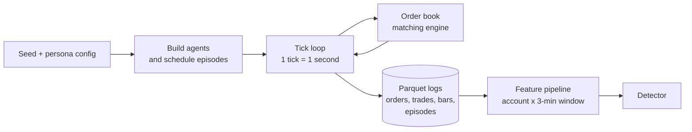

# How the Veridex market simulation works

A review guide to the simulation layer: what each Python module does, how seeds keep every market different (and reproducible), and what every Parquet file in a run contains.

All numbers in the examples come from run `adversarial_20261022T162828Z_seed222` (master seed 222, 5 rounds, 4 test markets per round, 5,000 ticks per market). New runs default to 2 test markets per round (`--test-markets` to change it).

---

## 1. The idea in one paragraph

Real exchanges never publish which accounts were manipulating, so a detector cannot be trained or graded on real data. Veridex builds its own futures market instead: an **agent-based simulation** with a real matching engine, ordinary traders, traders that look suspicious but are legitimate, and manipulators. Because the simulator plants the manipulation, it knows the **ground truth**: which account manipulated, how, and when. Every market is driven by a **seed**. The same seed always rebuilds the same market, byte for byte, and a different seed gives a different market.



**One market** = 8 commodities (crude WTI, Brent, gold, silver, natural gas, copper, wheat, corn), each simulated separately for 5,000 ticks (about 83 minutes of trading). In each run the per-commodity results are merged into one set of files.

---

## 2. Python modules

### 2.1 Engine (`src/core/`)

| Module | What it does |
|---|---|
| [`simulation.py`](../src/core/simulation.py) | The heart. `SimConfig` holds every setting (agent counts, persona knobs, tick counts). `run_simulation(config, seed)` builds the agents, schedules the manipulation episodes, runs the tick loop and writes the four logs. Also has `FundamentalValueProcess` (the hidden "true value" random walk with jumps), `multi_commodity_seed` and the 100-tick OHLCV resampler. |
| [`order_book.py`](../src/core/order_book.py) | A continuous double-auction **limit order book**, price-time priority. Orders rest, match, partially fill, expire or are cancelled. Contains no randomness and no ML. Prices only come from real matches between agents. |
| [`calibration.py`](../src/core/calibration.py) | Per-commodity realism inputs: starting prices, contract tick sizes, daily drift and volatility (fitted from real futures history; the loop uses the stored fallback values), and how likely each manipulation type is in that commodity. |
| [`persona_params.py`](../src/core/persona_params.py) | Maps the manipulation settings in `configs/persona_config.yaml` (the knobs the LLM strategist mutates) onto `SimConfig` fields. |

### 2.2 Legitimate traders (`src/core/agents/`)

Every agent subclasses [`base.py`](../src/core/agents/base.py). That base class gives each agent deterministic order IDs, tick-size price snapping, order expiry and a frozen depth reference for sizing orders.

| Module | Account IDs | Count per commodity | Behaviour |
|---|---|---|---|
| `noise_trader.py` | `noise_*` | 20 | Random small orders around the price; the background flow |
| `momentum_trader.py` | `momentum_*` | 8 | Buy rising prices and sell falling ones (speculators) |
| `mean_reversion_trader.py` | `meanrev_*` | 6 | Trade toward the fundamental value; keep prices anchored |
| `market_maker.py` | `mm_*` | 1 | Two-sided quotes every tick, inventory skew; main liquidity |
| `hft_liquidity_provider.py` | `hft_*` | 3 | High-cancel quoting ladders (legitimate high cancel rates) |
| `execution_algo.py` | `algo_*` | 3 | Works big institutional orders and re-posts them when the price moves |
| `institutional_crossing.py` | `rebalance_*` | 2 | Crosses clients' orders against each other. **Looks like wash trading** |
| `occasional_trader.py` | `occ_*` | 25 | Rare small trades, the same footprint as a manipulator's quiet periods |
| `lookalikes.py` | `lp_*`, `hedger_*`, `fund_*` | 3 / 3 / 2 | Quote-protecting LPs (**look like spoofing**), ladder hedgers (**look like layering**), fund families (**look like pump-and-dump**) |

The look-alikes are deliberate. Real surveillance spends most of its effort on legitimate behaviour that looks like manipulation, so the detector has to learn the difference.

### 2.3 Manipulators (`src/core/agents/manipulation/`)

| Module | Account IDs | Scheme (each modelled on CFTC enforcement cases) |
|---|---|---|
| `common.py` | – | `ManipulatorAccount` and `ManipulationController`. Outside its episode a manipulator account trades like an ordinary small trader, so being active is not a giveaway on its own. |
| `spoofing.py` | `spoofer_*` | Places a big fake order on one side, gets filled on the other side, then cancels the fake order (Coscia, Sarao) |
| `layering.py` | `layerer_*` | Stacks several fake orders on consecutive price levels and cancels them together (Sarao) |
| `wash_trading.py` | `wash_*` | Two or more colluding accounts trade with each other without changing who owns what (Cargill, Shinhan) |
| `pump_and_dump.py` | `pnd_*` | Several accounts accumulate quietly, push the price up with aggressive buying, then sell into the rise |
| `replay.py` | – | Replays scripted real enforcement cases (only in the real-case benchmark) |

### 2.4 Loop and helpers

| Module | Role |
|---|---|
| [`scripts/run_simulation.py`](../scripts/run_simulation.py) | Command-line entry point. Simulates the 8 commodities in parallel worker processes, merges them, writes one market folder. Exits with an error if any commodity fails. |
| [`src/adversarial/orchestrator.py`](../src/adversarial/orchestrator.py) | The adversarial loop. Decides which markets each round needs, gives each its seed (section 3), runs them concurrently, caches features and trains and scores the detector. |
| [`src/adversarial/variants.py`](../src/adversarial/variants.py) | Builds **randomised persona variants**: the current settings with 3–6 knobs redrawn, used for training diversity and for the fixed benchmark. |

### 2.5 What happens in one tick

1. The fundamental value takes one random step, sometimes with a news jump.
2. Expired orders and scheduled cancels are removed.
3. The market maker re-quotes.
4. All other agents and manipulators act **in a random order, reshuffled every tick from the seed**, so no trader always gets the first look at the book. Each one sees the updated book.
5. Every order event and trade is logged.

---

## 3. Seeds: why every market is different

### 3.1 One seed controls everything inside a market

`run_simulation(config, seed)` creates `master_rng = numpy.random.default_rng(seed)`, and **all randomness is derived from it**:

| Drawn from the seed | Effect |
|---|---|
| `fundamental_rng` (spawned) | The hidden value path and news jumps, and therefore the price trend |
| `order_rng` (spawned) | Which agent acts first in each tick |
| One child stream per agent | Every agent's order sizes, prices, timing and cancels |
| `master_rng` directly | **Number of episodes, which manipulation types, start times, durations** (e.g. spoofing 140–420 ticks), ±5% jitter on persona settings |
| `default_rng([seed, 991])` | Real-case replays, kept separate so they don't shift the others |

As a result, the **same seed and config give byte-identical output** (requirement SRS FR-0.4; order and trade IDs are deterministic, with no `uuid4`), and a different seed changes the prices, the order flow, and when and how the manipulation happens.

### 3.2 Each commodity gets its own seed

Inside one market, each commodity is simulated with

```
commodity_seed = (market_seed × 10007 + crc32(commodity_name)) mod (2³¹ − 1)
```

so gold and silver never share a random path. `crc32` is used instead of Python's `hash()` because `hash()` changes between processes. The commodity seed also forms the ID prefix that keeps every ID unique after merging. For example, `cru180420781-T1` is crude oil's trade 1 in market seed 233.

### 3.3 Each market in the loop gets its own seed

With master seed `S` (222 here), round `r`, test market `m` (0 to n−1: 4 markets in this run, 2 by default now), variant `v` and benchmark `b`:

| Market | Seed formula | Seed 222, round 1 | Persona settings | Purpose |
|---|---|---|---|---|
| Train | `S + 10r` | 232 | This round's mutation | Retraining data |
| Test markets | `S + 10r + 1 + m` | 233, 234, 235, 236 | This round's mutation | Scoring (`pre` / `post` / `r0`) |
| Train variant | `S + 50000 + 10r + v` | 50232 | Randomised variant of this round's | Training diversity (half length) |
| Benchmark | `S + 90000 + b` | 90222, 90223 (every round) | Fixed random variant of the baseline | Same unseen markets every round (`bench`) |
| Probes | 9101, 9102 (fixed) | – | Candidate mutation | Strategist tries candidates on short markets |

What this guarantees:
- **No market is ever re-used.** Each round steps by 10 and uses 1 + 4 of those 10 slots. Variants live at +50,000 and the benchmark at +90,000, so the ranges cannot collide. The run records `probe_run_seed_overlap` in `metrics.json` to show the probe seeds never clash with run seeds.
- **Train and test markets are different markets.** They share the rules and settings but have different prices, order flow and episode timing, so the test is a held-out market, not a held-out slice of the training market.
- **The benchmark is fixed.** Its seeds and variant settings (`default_rng([S, 99999, b])`) never change, so `bench` compares every round's detector on exactly the same unseen markets.
- **Different master seeds are separate experiments.** seed222 and seed333 share no market.

The variant settings use their own seeded draw, `default_rng([S, r, v])`, so a variant's settings are reproducible too.

### 3.4 Tick offsets

Each test market's ticks are shifted (`tick_offset = (r × 4 + m) × 5000`, e.g. round 1 test 0 starts at tick 20,000), so markets sit one after another on a single timeline in the dashboards. This only relabels ticks. It doesn't change the market itself.

---

## 4. Run folder layout

```
data/runs/adversarial_<timestamp>_seed<S>/
├── round_summary.parquet        all rounds x personas x phases (pre/post/r0/bench)
├── round_metrics.parquet        schema-checked pre/post subset
├── llm_calls.jsonl, llm_reasoning.log, probe_baseline.json, adversarial_metrics_plot.png
├── benchmark/market_0, market_1 one market folder each (+ variant_persona_config.yaml)
└── round_<r>/
    ├── train/                   market folder (seed S+10r)
    ├── train_variant/           market folder (+ variant_persona_config.yaml)
    ├── test, test_1, test_2, test_3/   market folders (held-out)
    ├── flags.parquet            detector output on the 4 test markets
    ├── metrics.json, thresholds.json, strategist.json, shap_importance.json, feature_importances.json
    └── models/                  detector.joblib, bar_model.joblib, manifest.json
```

Each **market folder** holds: `order_log`, `trade_log`, `ohlcv_bars`, `manipulation_events` (written by the simulator), `features` and `labels` (written by the feature pipeline), `bars_1m` (the web app's cache) and `run_metadata.yaml` (run ID, seed, ticks, commodities).

---

## 5. What each Parquet file contains

Sizes are from `round_1/test` (one market, 8 commodities, 5,000 ticks).

### 5.1 Simulator output: the raw market

**`order_log.parquet`** – every order event. *About 2.4 M rows, 20 MB.*

| Column | Meaning |
|---|---|
| `order_id` | `<prefix><trader_id>-<n>`, deterministic |
| `trader_id` | Account that owns the order |
| `side` | `buy` / `sell` |
| `price`, `quantity` | Limit price (on the contract's tick grid) and size |
| `tick` | Time in seconds |
| `event_type` | `placed` (1.03 M), `cancelled` (527 k), `filled` (506 k), `partial_fill` (299 k), `rejected_cancel` (cancel arrived after the fill) |
| `commodity` | Market |

**`trade_log.parquet`** – every execution. *About 494 k rows, 4.6 MB.*

| Column | Meaning |
|---|---|
| `trade_id` | Deterministic ID |
| `tick`, `price`, `quantity` | When, at what price, how much |
| `buyer_trader_id`, `seller_trader_id` | Both sides of the trade (what lets the detector find wash rings) |
| `aggressor_side` | Which side crossed the spread |
| `commodity` | Market |

**`ohlcv_bars.parquet`** – 100-tick price bars. *408 rows.* `bar_start`, `open`, `high`, `low`, `close`, `volume`, `commodity`. Used for price charts.

**`manipulation_events.parquet`** – **the ground truth**. *32 rows: 4 episodes × 8 commodities, one of each type per commodity in this market.*

| Column | Meaning |
|---|---|
| `event_id` | e.g. `cru180420781-E0` |
| `persona` | `spoofing`, `layering`, `wash_trading`, `pump_and_dump` |
| `start_tick`, `end_tick` | Episode span, e.g. spoofing 21,123–21,338 |
| `trader_ids` | Accounts involved, e.g. `[spoofer_0]` or `[pnd_1_0 … pnd_1_4]` |
| `parameters` | The exact persona settings used (size multiplier, cancel delay, accounts…) |
| `commodity` | Market |

The detector **never sees** this file. It is only used to build labels and to grade the detector.

### 5.2 Feature pipeline output: what the detector learns from

**`features.parquet`** – one row per **account × 3-minute window** (windows slide every 30 s). *128 k rows × 64 features.* Index: `(commodity, window_start, trader_id)`. The designated market maker (`mm_*`) is excluded. Feature groups:
- order behaviour: order counts, sizes relative to book depth, cancel ratios, fast and large cancels, layered orders;
- execution: fills, volume, aggressor share, own-side vs opposite-side fills;
- counterparties: mutual trading share, ring concentration, self-crossing (wash);
- timing and coordination: order bursts, linked accounts acting together (cross-account features);
- market context: price moves, volume spikes, spread;
- peer-relative and self-history: the account compared with others now, and with itself earlier.

`features.version` stores the feature-code version (currently 5), so a stale cache is rebuilt automatically.

**`labels.parquet`** – same index as features, 4 columns (`spoofing`, `wash_trading`, `pump_and_dump`, `layering`), 0/1. A window is 1 when the account belongs to an episode **and** placed at least one of that scheme's manipulative orders inside the window. Quiet periods inside an episode stay 0. In this market: wash 1,122, pump-and-dump 446, layering 106, spoofing 104 positives out of 128 k windows (**about 1.4% positive**).

### 5.3 Detector output

**`round_<r>/flags.parquet`** – the retrained detector's verdict on every window of the 4 test markets. *About 513 k rows, 9 MB.*

| Column | Meaning |
|---|---|
| `commodity`, `window_start`, `window_end`, `trader_id` | Which account and window |
| `final_flag` | Raised an alert (True/False) |
| `final_score` | Combined score 0–1 |
| `predicted_persona` | Which scheme it looks like (or `anomaly`) |
| `persona_scores` | Each classifier's probability |
| `iso_score` | Isolation Forest unusualness |
| `alert_tier` | `alert` (14 k), `review` (814, unusual but unconfirmed), `none` |
| `triggered_by` | Which layer fired (classifier, anomaly, …) |
| `top_shap_features` | The features that pushed the score most (explanation) |

The web app's Surveillance page merges consecutive flagged windows into **cases** and checks them against `manipulation_events`.

### 5.4 Run-level results

**`round_summary.parquet`** – one row per round × persona × phase. *68 rows.*

| Column | Meaning |
|---|---|
| `round`, `persona`, `phase` | `pre` (frozen detector), `post` (retrained), `r0` (round-0 detector), `bench` (fixed benchmark) |
| `precision`, `recall`, `f1`, `fpr`, `support` | Window-level classification scores |
| `events_total`, `events_detected`, `episode_coverage` | How many planted episodes were caught with the right label |
| `caught_coverage`, `family_coverage` | Caught by any alert; caught as the fake-depth family (spoofing ∪ layering) |
| `detection_latency_ticks` | Seconds from episode start to first alert |
| `effectiveness_ratio`, `mutation_score` | How much manipulative effect the mutation kept, and its evasion × effect score |

**`round_metrics.parquet`** – the `pre`/`post` rows in a fixed, schema-validated format (`round_num`, `commodity`, `persona`, `precision`, `recall`, `f1`, `fpr`, `detection_latency_ticks`, `is_post_retrain`). It's kept for the SRS §6.1 contract.

**`bars_1m.parquet`** – 1-minute OHLCV bars per commodity, built from `trade_log` by the web app and cached. They're only used by the bar-level live model and the charts.

---

## 6. Likely review questions

- **Why simulate instead of using real data?** Real order books never come with "this account was spoofing" labels. The simulator plants manipulation and knows the truth, so the detector can be graded exactly.
- **Is it realistic?** Prices come only from matched orders; the trader mix follows CFTC Commitments of Traders categories; daily volatility is calibrated per commodity; each manipulation scheme follows a documented enforcement case; and there are legitimate look-alikes for every scheme.
- **Could the test leak into training?** No. Test markets have their own seeds, so their prices, order flow and episode timing differ from the training market. The detector never reads `manipulation_events`. The run checks that probe seeds never overlap run seeds.
- **Can a result be reproduced?** Yes. Re-running with the same master seed and the same persona settings gives identical files.
